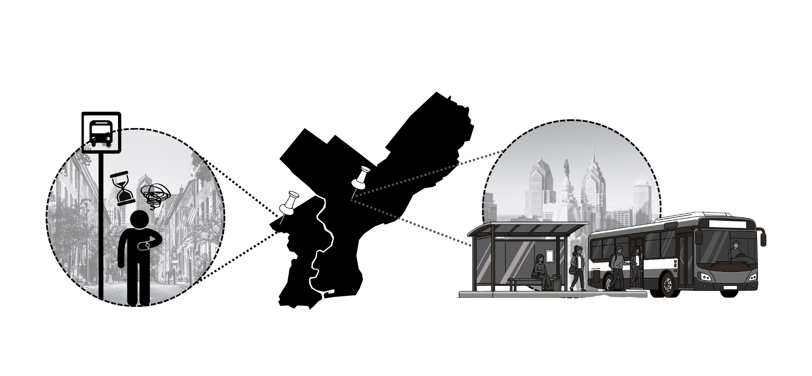
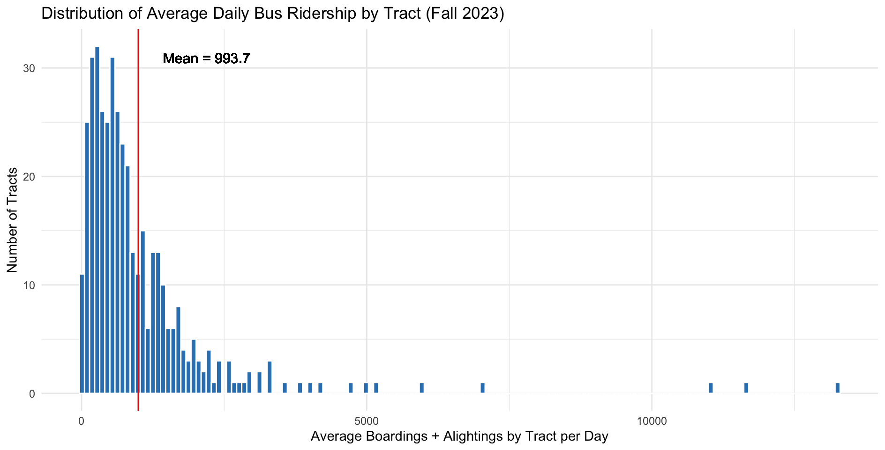
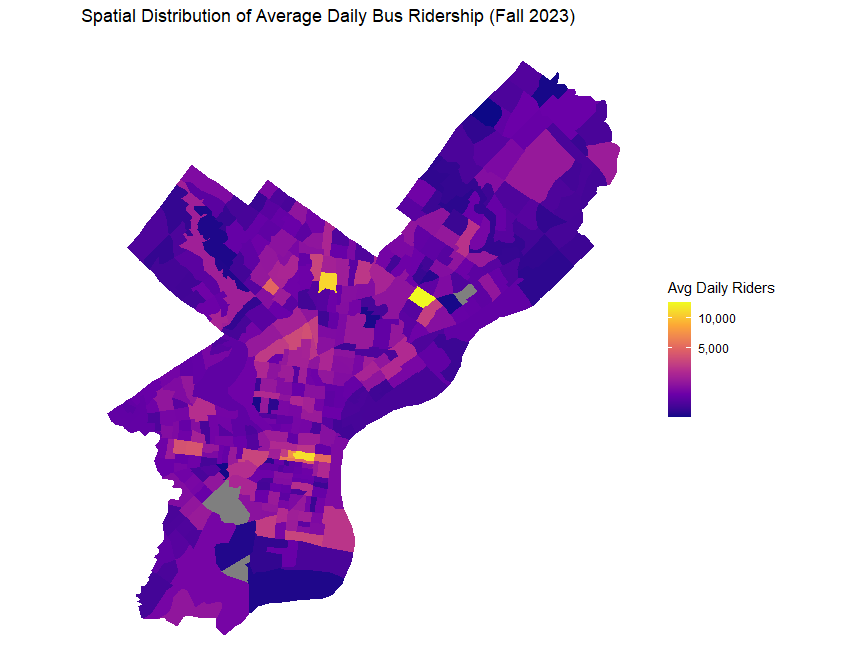
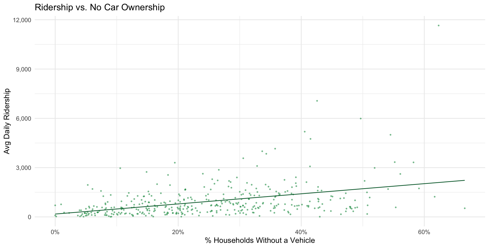
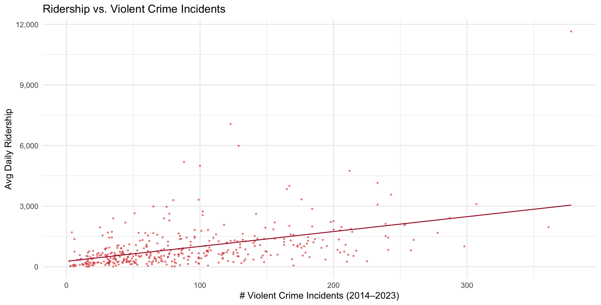
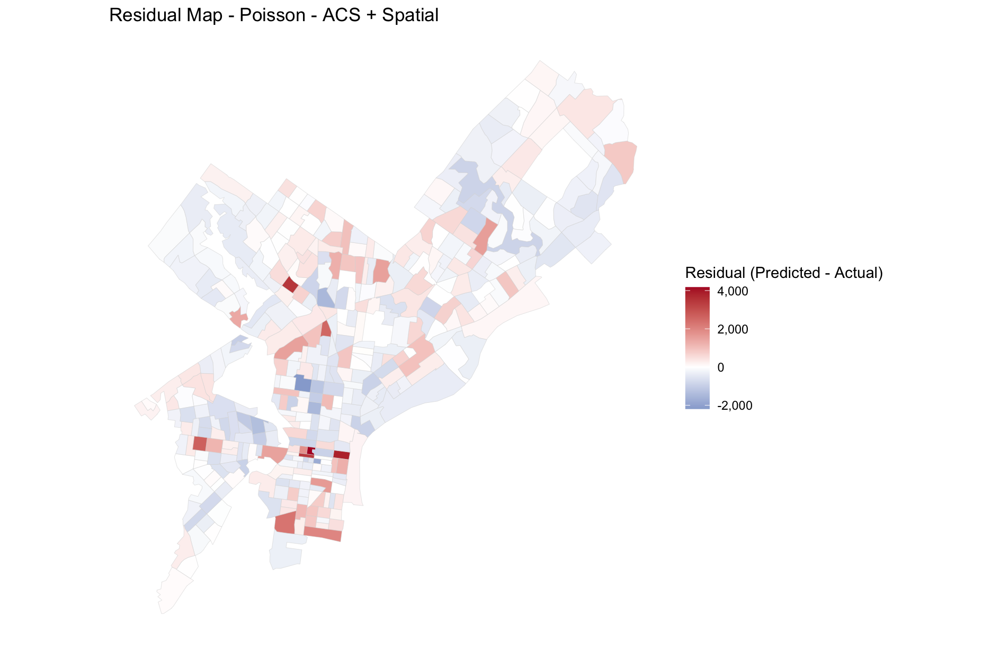
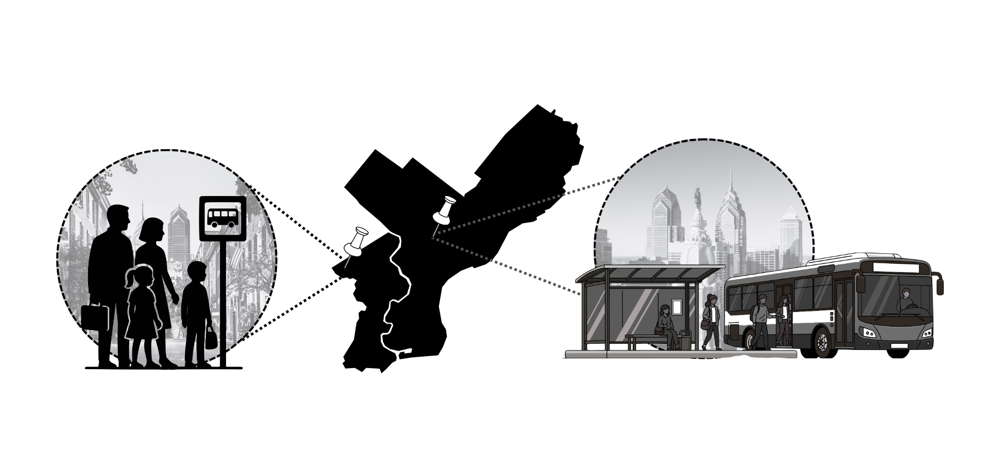

##  A Tale of Two Neighborhoods

- Charlie in West Philly: long waits, rising population
- Center City: frequent service, stable demand
- Planning relies on past ridership… but neighborhoods are changing

{width="100%" align="center"}

---

## The Problem

- Transit planning relies on historical ridership.
- Hard to see where demand is emerging.
- Risk of investing in wrong places.
- Inequities worsen when growing neighborhoods are overlooked.

---

## Policy Question

> **Where will ridership grow next, and how should the city prepare?**

### Why This Matters

- **Misaligned predictions** -> overcrowded routes, underutilized infrastructure, and widening inequities in transit access.
- **More accurate assessments** -> fairer resources allocation, transit equity.
- **Transparent and data-driven modeling** builds trust and accountability in city governance.

---

## Our Solution
A census-tract–level ridership demand prediction model

- Future ridership forecasts
- Fine spatial detail
- Multi-source data integration

---

## Why It Helps
Prediction supports:

- Identifying emerging and high cluster demand
- Anticipating future strain on routes
- Guiding equitable investment
- Revealing suppressed demand

---

## Data Overview

### Our Data Foundation

- **SEPTA Ridership Statistics**  
  **400 census tracts** with average daily on and off passenger number during fall 2023.

- **Neighborhood & Contextual Data**
  Combined city (OpenDataPhilly) and census (ACS 2023) information on:
  - **Demographics:** race, household income, employment, education, car ownership
  - **Public safety:** proximity to violent crime
  - **Accessibility:** commute time
  - **Amenities & services:** universities, hospitals

---

## What Do Ridership Look Like?

{width="100%" align="center"}

**Key Findings**

Most census tracts have relatively low bus activity, while a small number of tracts account for extremely high ridership, creating a heavily skewed distribution.

---

## Where Are High Ridership Demands Area?

::: columns
::: column
**Key Findings:**

- Ridership is highly concentrated in a small number of tracts, shown by the bright yellow hotspots.
- High-ridership areas align with major transit corridors or dense activity centers (e.g., employment hubs, commercial districts).
- Most tracts have relatively low to moderate ridership, reflected by the predominance of darker purple shades.
:::

::: column
{width="120%" align="right"}
:::
:::

---

## Ridership & Car Ownership

{width="100%" align="center"}

**Key Findings:**

- Tracts with higher shares of households without a vehicle show notably higher bus ridership.
- This indicates that household transportation access is a key driver of bus usage.

---

## Ridership & Crime Incidents

{width="100%" align="center"}

**Key Findings:**

- Tracts with more violent incidents tend to have higher bus ridership.
- This likely reflects broader socio-economic conditions rather than crime itself.

---

## What Makes Our Approach Better?
- Not dependent on outdated surveys
- Combines multiple data layers
- Spatially granular (census tract)
- Forward-looking, not reactive

---

## How Does Model Performance Improve?

| Model                             | CV MAE (riders) | R²    |
|-----------------------------------|------------------|-------|
| KDE - Spatial Only                | 582              | 0.19  |
| OLS – ACS only                    | 615              | 0.21  |
| OLS – ACS + Spatial               | 527              | 0.43  |
| OLS – ACS + Spatial + FE          | 532              | 0.70  |
| Poisson – ACS only                | 608              | 0.26  |
| **Poisson – ACS + Spatial**       | **477**          | **0.58**|
| Poisson – ACS + Spatial + FE      | 491              | 0.77  |

Each additional data layer improves accuracy, with adding spatial features producing the largest jump.

---

## What Drives the Improvement?

- **Census & Socioeconomic Context** captures population, race, employment, education, car ownership, commute time.
- **Adding Spatial Data** accounts for proximity to universities, hospitals, and violent crime.
- **Adding Neighborhood Fixed Effects** controls for unobserved local traits.

---

## Best Models

| Model                                      | CV MAE (riders) | R² |
|--------------------------------------------|-----------|----|
| **Poisson – ACS + Spatial**       | **477**          | **0.58**|

The model captures **demographic**, **socioeconomic**, and **spatial** factors.

**Top Predictors**
- Violent crime incidents
- Car ownership
- % Asian residents
- Population Density

---

## Hardest To Predict

{width="75%" align="center"}

- Residuals are calculated as actual ridership minus predicted ridership.
- Center city and South Philadelphia have over predicted values, while North and West Philadelphia show under predicted values.

---

## Implementation: How the City Can Use It

**Key Actions**
- Anticipate future demand
- Prioritize investments
- Support bus network redesign
- Strengthen grant applications

---

## Data Required

- Hourly, stop-level ridership counts
- Transit schedule data
- ACS demographic data
- Spatial data (crime, POIs, land use)
- Development projections

---

## Costs & Benefits

**Benefits:**
- Proactive, equitable planning
- Higher ridership
- Resource efficiency
- Better access for residents

**Costs:**
- Data pipelines
- Training
- Model maintenance

---

## Safeguards

- Annual fairness audits
- Public documentation
- Human oversight
- Use predictions to enhance service, not cut it!

---

## Looking Forward

**Limitations**
- **Restricted data sources:** Lack of stop-level data; key factors such as transit supply could be included.
- Time misalignment across datasets.
- Remaining spatial autocorrelation + coarse neighborhood fixed effects.

**Next Steps**
- Include OSM networks, land-use patterns, accessibility metrics, detailed transit service supply.
- Explore spatial regression or ML methods for non-linear and spatial patterns.

---

## Closing Story: A Better Future Commute

Charlie’s commute:
- Prediction identifies rising demand
- City increases frequency early
- Reliable, shorter commute

{width="100%" align="center"}

---

# THANK YOU!
